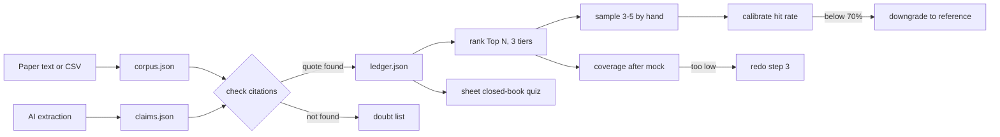
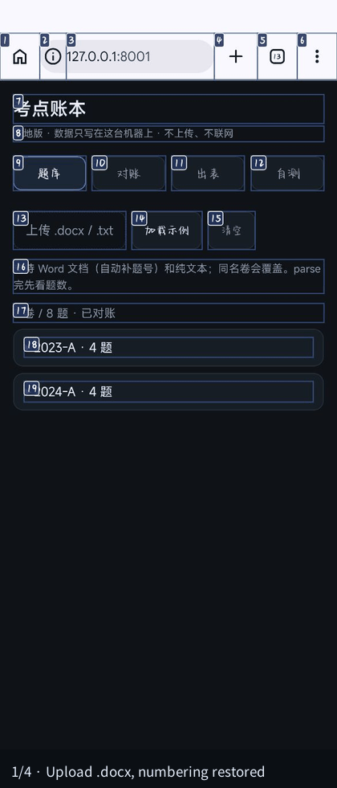

# Kaodian Ledger · 考点账本

[中文](README.md) | [English](README.en.md)

The failure mode of AI exam prep is not a missed topic — it is an invented one.
When a model says "this appeared four times in the last five years", you cannot
check it; you can only believe it. Kaodian Ledger (考点账本, "exam-point ledger")
puts a mechanical check behind every claim: the sentence it quotes must appear
verbatim in the question it cites. If the quote cannot be found, the claim goes
to the doubt list — not to your revision list.

It implements the four checkpoints of the method that can be automated:

- ③ citations — a script decides, not the model's good faith
- ⑤ calibration — sample 3–5 claims by hand; below 70% everything is downgraded to "reference only"
- ⑥ recall vs recognition — every quiz question must attach to a verified point, answers are separated
- ⑦ coverage — after a mock exam, compute how much of it was predicted; too low → redo step 3

No model memory, no copyrighted exam papers: the repository ships none, only fictional examples.

**Who it is for:** people who already have two or more past papers and have been burned by invented "high-frequency" topics.
**Who it is not for:** people with no corpus who want ready-made highlights — this tool provides no exam content, it only verifies what you feed it.

## The seven steps, as commands

③ is check, ④ rank, ⑤ sample + calibrate, ⑥ sheet, ⑦ coverage.

## What it does

| Command | What it does |
|---|---|
| parse | Split paper text / .docx into questions with year, number, score |
| import-csv | Convert an existing entry sheet (CSV) into corpus + claims |
| check | Verify every AI claim against the corpus; failures go to the doubt list |
| rank | Rank only verified claims; output Top N in three tiers |
| sample | Draw 3–5 claims from the Top N for manual checking |
| calibrate | Hit rate below the threshold (70% by default) → downgrade everything to "reference only" |
| sheet | Render a closed-book quiz with the answer key on the last page |
| coverage | After a mock exam, compute predicted coverage; misses that were in the doubt list are flagged |
| serve | Local web UI: library / check / report / quiz tabs, zero dependencies |
| grade | Write quiz results back to mistakes.json; re-running accumulates |
| review | Build a re-test list by "score × (1 + wrong count)"; untested must-knows are listed separately |

## Quickstart (5 minutes)

No third-party dependencies. Python 3.9+. Runs on a phone.

    # 1. Ingest (the example corpus is fictional; use your own)
    python3 ledger.py parse examples/corpus --out out/corpus.json

    # 2. Extract: feed prompts/extract.md and corpus.json to a model
    #    It may only output claims.json

    # 3. Check citations
    python3 ledger.py check examples/claims.json --corpus out/corpus.json --out out/ledger.json

    # 4. Report
    python3 ledger.py rank out/ledger.json --out out/report.md

    # 5. Manual check of 3–5 claims
    python3 ledger.py sample out/ledger.json --n 3 --seed 42 --out out/samples.json
    #    edit result in samples.json to hit or miss
    python3 ledger.py calibrate out/samples.json --out out/calibration.json

    # 6. Rebuild the report with the calibration result
    python3 ledger.py rank out/ledger.json --calibration out/calibration.json --out out/report.md

    # 7. After a mock exam: list the topics it actually tested
    python3 ledger.py coverage out/ledger.json --actual examples/actual-mock.json --aliases examples/aliases.json --md out/coverage.md --out out/coverage.json

## Web UI

    python3 serve.py
    # open http://127.0.0.1:8000 in a phone or desktop browser

Four tabs:

- Library: upload .docx / .txt (or load the demo), inspect parsed questions and scores
- Check: paste claims.json; doubtful rows turn red with the reason
- Report: Top N in three tiers, downloadable as markdown
- Quiz: paste quiz.json, mark each answer right/wrong, get a re-test list sorted by mistakes

Data stays in the local data/ directory. Nothing is uploaded. The server binds
127.0.0.1 by default; --host 0.0.0.0 exposes it to your network — use at your own risk.

## Feeding your papers

In order of convenience:

1. Word: drop .docx files into a directory and parse. Questions numbered by Word's
   auto-numbering (invisible in the text) get 一.1 / 二.1 style numbers per section;
   legacy .doc must be re-saved as .docx.
2. Paste: plain text in the format from SPEC.md, one paper per .txt, numbers at line start ([1] or 1.).
3. Photo OCR: shoot pages straight and one per image, then convert to text; skip this for formula-heavy subjects.
4. Existing CSV: a sheet with year, number, stem, score, point, quote columns goes straight into import-csv.

Sectioned papers need no manual renumbering: 一、1 becomes 一.1, each section's
"X points per question" is inherited, and an unnumbered essay becomes question 1 of its section.

Three format traps: a line starting with "1." inside a stem is mistaken for the next
question (rewrite those as [1] after OCR); a mis-numbered option line such as
"2.A. bone membrane B. bone substance" is folded back into the previous question
instead of creating a phantom question; and a true/false stem may itself be a false
statement — without an answer key it proves only that the sentence is on the paper,
not that it is correct. Count the questions after parse: a mis-split pollutes the
whole ledger and is hard to notice later.

## The prompt pack

- prompts/extract.en.md: use only the supplied material; every claim needs a verbatim quote and a question number; anything unverifiable goes to absent.
- prompts/quiz.en.md: two closed-book questions per must-know item, one recall and one transfer; answers kept apart from the questions.
- prompts/capability-mode.en.md: for skill-type subjects, analyse question forms instead of betting on topics.

All three are paste-and-go prompts and are not tied to a specific model. Chinese originals:
extract.md, quiz.md, capability-mode.md.

## Example output

Using the fictional barista corpus in examples/:

| # | Tier | Point | Sources | Quote | Score |
|---:|---|---|---|---|---|
| 1 | Must-know | Processing flavour | 2023-A#4; 2024-A#4 | 发酵风味 / 发酵感与果香 | 3+3=6 |
| 2 | Must-know | Milk foam temperature | 2024-A#3; 2023-A#2 | 55-65 摄氏度 / 蛋白质变性 | 2+3=5 |
| 3 | Understand | Coffee-to-water ratio | 2023-A#3; 2024-A#2 | 粉水比 / 粉水比 | 2+2=4 |
| 4 | Understand | Natural processing | 2024-A#4 | 日晒处理法 | 3 |
| 5 | Optional | Extraction time | 2023-A#1 | 萃取时间一般控制 | 2 |

Doubt list (deliberately fabricated in the example):

    c7 水温对萃取的影响 | 2024-A#7 | "九十二度" → no question 7 in that paper
    c8 研磨度与萃取   | 2023-A#2 | "研磨度过细" → quote not found in that stem

Coverage (examples/actual-mock.json, 6 tested topics): 3/6 = 50%, below the 60% threshold.
The three misses — water temperature, water hardness, grind size — are exactly the three
claims that had no citable source. What you could not cite, the exam did ask. The report
flags them one by one.

## After the quiz: mistakes

Record each answer as results.json:

    {"results": [{"claim_id": "c5", "q": 1, "ok": false}]}

    python3 ledger.py grade --ledger out/ledger.json --results examples/results-demo.json --out out/mistakes.json
    python3 ledger.py review out/ledger.json --mistakes out/mistakes.json --out out/review.md

Re-running grade accumulates. Re-test priority is score × (1 + wrong count), so items you
keep missing float up; must-know items you have never tested are listed separately —
silence is not mastery.

| # | Point | Tier | Sources | Wrong/Right | Priority |
|---:|---|---|---|---|---|
| 1 | Processing flavour | Must-know | 2023-A#4; 2024-A#4 | 1/1 | 12 |

Never tested: Milk foam temperature | 2024-A#3; 2023-A#2

## Bridging an existing entry sheet

If you already keep a CSV with year, number, stem, score, point and quote columns:

    python3 ledger.py import-csv sheet.csv --out out/corpus.json --claims-out out/claims.json
    python3 ledger.py check out/claims.json --corpus out/corpus.json --out out/ledger.json

That quote column is verified for the first time here. Before, it was just written down;
now every quote that does not match its stem lands in the doubt list.

## Boundaries (more important than features)

- It checks whether the sentence is in that question, not whether the point fits. Semantics need the human sample step.
- Merging is literal plus aliases.json; without an entry, "milk foam temperature" and "foam temperature" are counted separately.
- A mis-split by OCR pollutes the ledger. Check the question count after parse.
- Missing scores are estimated from the median of known scores in the same paper and marked "est".
- The long-quote warning uses 10 CJK characters or 40 Latin characters; it is advisory, not a failure.
- For skill-type subjects (programming, writing, experiment design) probabilities are meaningless; use prompts/capability-mode.md for question-form analysis instead.
- The repository ships no real papers; examples/ is fictional.

## Why not just a prompt collection

Anyone can copy a prompt. What cannot be copied out of this repository is two JSON
files: corpus.json (your local question bank) and ledger.json (the verification record
of every claim). The first is a copyright boundary, the second is an auditable ledger.

Roadmap: see [ROADMAP.md](ROADMAP.md). Next up is content completeness (answer fields,
text-type PDF). Vector search is explicitly out of scope, for reasons written there.

MIT License
