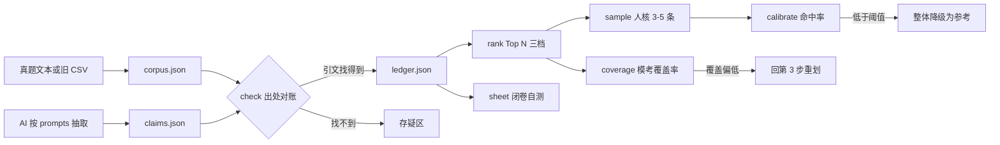

# 考点账本 · kaodian-ledger

AI 划重点最大的风险不是漏，是编。没有出处的「高频考点」，你没法查，只能信。
这个工具给每条重点加一道机械校验：它引用的那句话，必须能在你给的那套真题的那道题里
被程序原样找到。找不到就进存疑区，而不是进你的复习清单。

它落实的是那套方法里几个能机械化的检查点：

- ③ 有没有出处 → 对账脚本，机器判定，不靠 AI 自觉
- ⑤ 命中率靠不靠得住 → 抽 3–5 条人核，低于 70% 整体降级
- ⑥ 是背还是测 → 自测题必须挂回一条已核实的重点，答案强制分离
- ⑦ 预测覆盖了几成 → 模考后算覆盖率，低的回第 3 步重划

不碰 AI 的记忆，也不碰你的真题版权：仓库里没有任何真题，只有虚构的示例。

**适合谁**：手里已经有 2 套以上真题、想用 AI 但被编出来的「高频」坑过的人。
**不适合谁**：没有题库、想直接要一份现成重点的人——这里不提供任何考点，只校验你给的材料。

## 七步落到命令上

③ 是 check，④ 是 rank，⑤ 是 sample + calibrate，⑥ 是 sheet，⑦ 是 coverage。

## 它做什么

| 命令 | 作用 |
|---|---|
| parse | 真题文本 / .docx 切成「卷 → 题」，带年份、题号、分值 |
| import-csv | 已有的录入稿 CSV 直接转成题库 + 结论 |
| check | 拿着 AI 给的结论逐条回题库查出处，查不到的进存疑区 |
| rank | 只排在已核实的结论上，输出 Top N 和三档 |
| sample | 从 Top N 随机抽 3–5 条，生成人工核对表 |
| calibrate | 命中率低于阈值（默认 70%）→ 整体降级为「仅参考」 |
| sheet | 自测题渲染成闭卷题面，答案单独放最后一页 |
| coverage | 模考后算预测覆盖率；没覆盖的会标出当初在不在存疑区 |
| serve | 本地网页版：题库 / 对账 / 出表三页签，零依赖 |
| grade | 自测结果回写 mistakes.json，重复跑会累加 |
| review | 按「分值 × (1 + 错次)」出重测清单，没测过的必背项单列 |

## 5 分钟上手

无第三方依赖，Python 3.9+ 就能跑，手机上也能跑。

    # 1. 入库（示例里是虚构题库，换成你自己的）
    python3 ledger.py parse examples/corpus --out out/corpus.json

    # 2. 抽取：把 prompts/extract.md 和 corpus.json 一起丢给模型
    #    它只会输出 claims.json

    # 3. 对账
    python3 ledger.py check examples/claims.json --corpus out/corpus.json --out out/ledger.json

    # 4. 出表
    python3 ledger.py rank out/ledger.json --out out/report.md

    # 5. 人核 3–5 条
    python3 ledger.py sample out/ledger.json --n 3 --seed 42 --out out/samples.json
    #    把 samples.json 里的 result 改成 hit 或 miss
    python3 ledger.py calibrate out/samples.json --out out/calibration.json

    # 6. 带上校准结果重新出表
    python3 ledger.py rank out/ledger.json --calibration out/calibration.json --out out/report.md

    # 7. 模考后：实际考点按 examples/actual-mock.json 的格式写下来
    python3 ledger.py coverage out/ledger.json --actual examples/actual-mock.json --aliases examples/aliases.json --md out/coverage.md --out out/coverage.json

## 网页版（不想敲命令）

    python3 serve.py
    # 手机或电脑浏览器打开 http://127.0.0.1:8000

四个页签：

- 题库：上传 .docx / .txt，或者点「加载示例」，看切出来的题和分值
- 对账：贴 claims.json，存疑区标红，原因写清楚
- 出表：Top N + 三档，可下载 markdown
- 自测：贴 quiz.json 做闭卷题，点「对 / 错」记结果，提交后自动按错次排重测清单

数据只写在本机 data/ 目录，不联网、不上传。默认只绑 127.0.0.1；
要让同网段设备访问才加 --host 0.0.0.0（有风险，自己想清楚）。

## 怎么把真题喂进去

按省事程度排：

1. Word：把 .docx 丢进一个目录，直接 parse。正文里看不到题号的那些（靠 Word 自动编号）
   会按节补成 一.1 / 二.1；老式 .doc 先另存为 .docx。
2. 粘贴：题干纯文本按 SPEC 的格式整理，一卷一个 .txt，题号写在行首（[1] 或 1.）。
3. 拍照 OCR：整页拍正、一页一张，先转文字再切题；公式和图多的科目别硬上。
4. 旧 CSV：已有「年份,题号,题干原文,分值,知识点,原文摘录」的表，直接 import-csv。

分节卷不用手动改题号：一、1 自动变成 一.1，每节的「每题 X 分」也会继承，
没题号的简答/论述会收成该节第 1 题。

三个格式坑：题干里以「1.」开头的列表会被当成下一题，OCR 后统一改成 [1]；
选项行被误编号（如「2.A. 骨膜 B. 骨质」）会并回上一题，不会多出一道假题；
判断题的题干可能是一句错话，没有答案时它只证明「在卷子上」，不证明「是对的」。
parse 完先看题数——切错题会污染整个账本，而且很难自动发现。

## 提示词三件套

- prompts/extract.md：只准用你给的材料，每条结论必须带逐字引文和题号；算不出的进 absent。
- prompts/quiz.md：每个必背项 2 道闭卷题，回忆型 + 迁移型，答案和题面分开。
- prompts/capability-mode.md：能力型科目换成题型分析，不押知识点、不给概率。

三份都是「贴进去就能用」的整段，不绑定特定模型。

## 跑出来长什么样

用 examples/ 里的虚构咖啡师题库：

| # | 档 | 知识点 | 出处 | 原题摘录 | 分值 |
|---:|---|---|---|---|---|
| 1 | 必背 | 处理法风味 | 2023-A#4; 2024-A#4 | 发酵风味 / 发酵感与果香 | 3+3=6 |
| 2 | 必背 | 牛奶发泡温度 | 2024-A#3; 2023-A#2 | 55-65 摄氏度 / 蛋白质变性 | 2+3=5 |
| 3 | 理解 | 粉水比 | 2023-A#3; 2024-A#2 | 粉水比 / 粉水比 | 2+2=4 |
| 4 | 理解 | 日晒处理 | 2024-A#4 | 日晒处理法 | 3 |
| 5 | 可放弃 | 萃取时间 | 2023-A#1 | 萃取时间一般控制 | 2 |

存疑区（示例里是故意编的）：

    c7 水温对萃取的影响 | 2024-A#7 | "九十二度" → 该卷里找不到这个题号
    c8 研磨度与萃取   | 2023-A#2 | "研磨度过细" → 引文在该题题干里找不到

模考覆盖率（examples/actual-mock.json，6 个实际考点）：3/6 = 50%，低于 60% 阈值。
没覆盖的三条——水温、水质硬度、研磨度——正好是当初存疑区里给不出出处的那三条：
你当时标不出来的，考试真考了。报告会逐条标出来，不用自己对照。

## 自测之后：错题回写

sheet 做完，把每题结果记成 results.json：

    {"results": [{"claim_id": "c5", "q": 1, "ok": false}]}

    python3 ledger.py grade --ledger out/ledger.json --results examples/results-demo.json --out out/mistakes.json
    python3 ledger.py review out/ledger.json --mistakes out/mistakes.json --out out/review.md

重复 grade 会累加。重测优先级 = 分值 × (1 + 错次)，错得越多越靠前；
从没测过的必背项单独列出来——沉默不等于掌握。

| # | 知识点 | 档 | 出处 | 错/对 | 优先级 |
|---:|---|---|---|---|---|
| 1 | 处理法风味 | 必背 | 2023-A#4; 2024-A#4 | 1/1 | 12 |

还没测过的必背项：牛奶发泡温度 | 2024-A#3; 2023-A#2

## 和旧录入稿的桥接

如果你手里已经有一张按「年份,题号,题干原文,分值,知识点,原文摘录」记的 CSV：

    python3 ledger.py import-csv 录入稿.csv --out out/corpus.json --claims-out out/claims.json
    python3 ledger.py check out/claims.json --corpus out/corpus.json --out out/ledger.json

「原文摘录」这一列第一次会被真正校验。以前它只是抄在那里，现在对不上题干的会全部落进存疑区。

## 边界（比功能重要）

- 只核「这句话在不在那道题里」，不核「这个知识点贴不贴」。语义靠 sample 人核。
- 归并按 aliases.json 合并；不写进去，「牛奶发泡温度」和「奶泡温度」就各算各的。
- OCR 切错题会污染整个账本。parse 完先看题数对不对。
- 分值缺失按同卷已知分值的中位数估，表里标「估」。
- 能力型科目（编程 / 写作 / 实验设计）概率没有意义，用 prompts/capability-mode.md 换成题型分析。
- 仓库不带任何真题，examples/ 里是虚构题目。

## 为什么不是 prompt 合集

prompt 谁都能复制。这个仓库真正带不走的是两个 JSON：corpus.json（你本地的题库）
和 ledger.json（每条结论的校验记录）。前者是版权边界，后者是可复算的账。

路线图见 [ROADMAP.md](ROADMAP.md)：v0.3 解决喂料门槛（PDF / 整卷粘贴），v0.4 做错题回写；
向量检索不在计划里，理由写在里面。

MIT License
